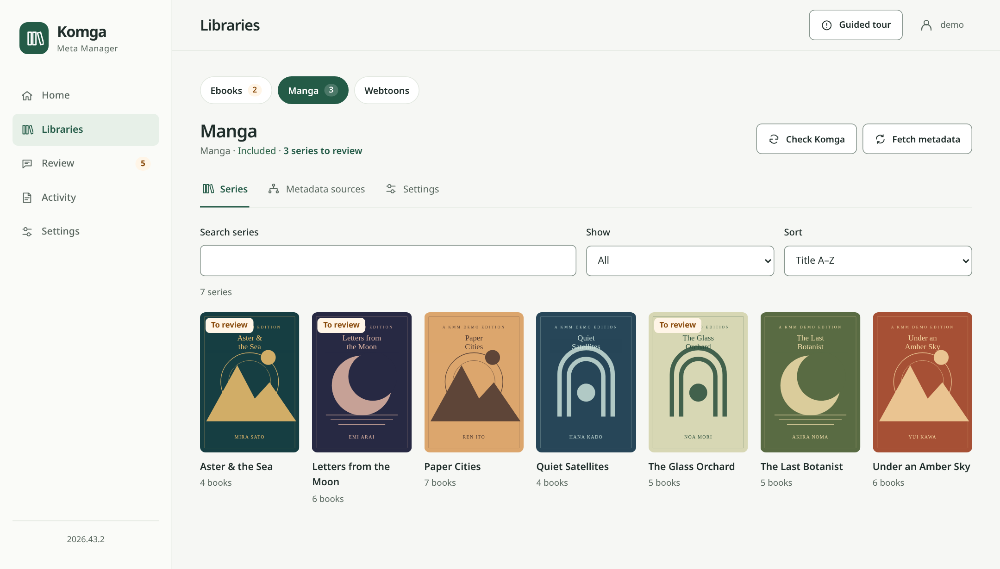
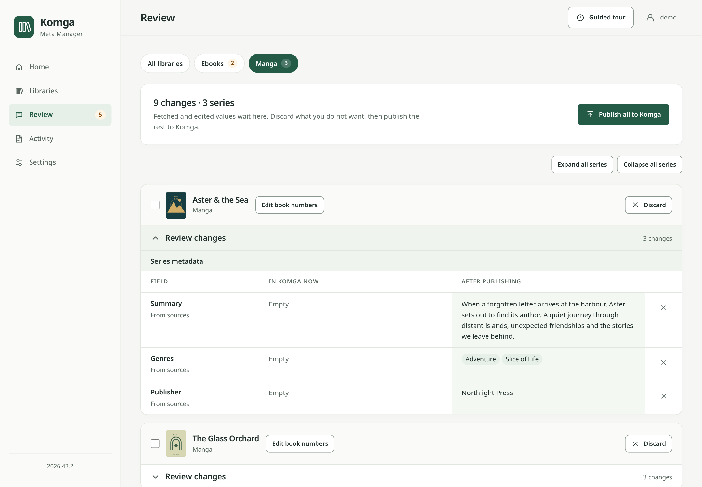
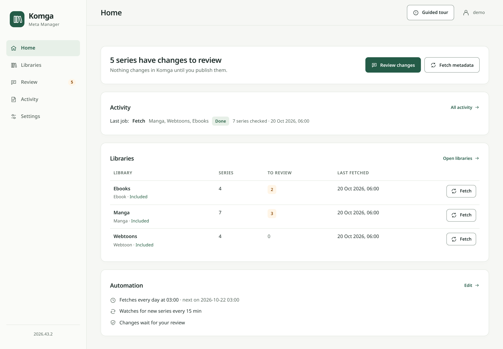
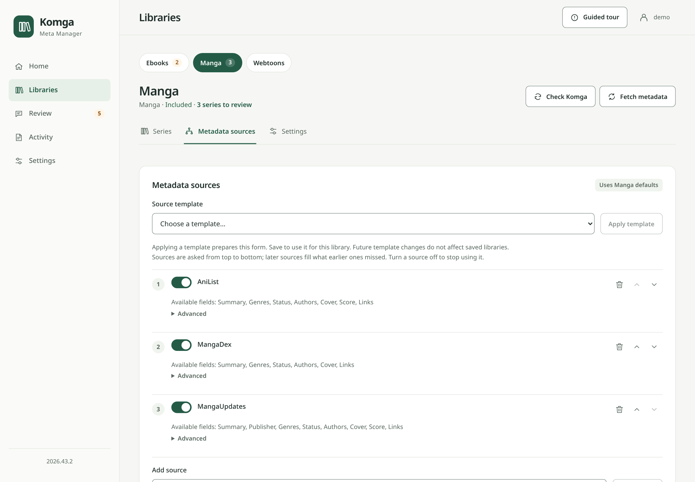
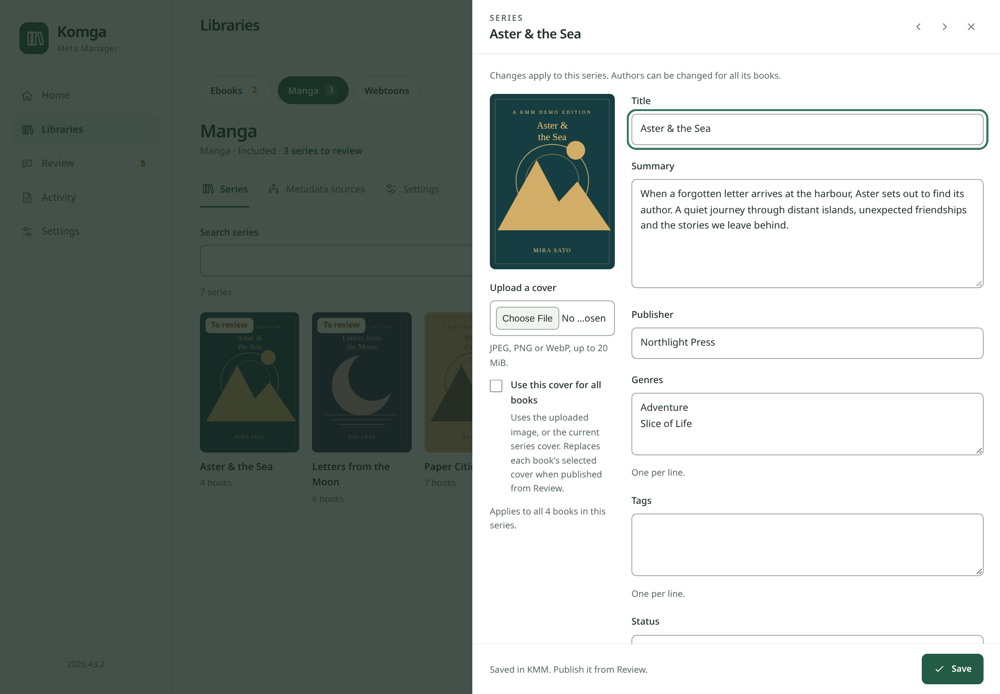
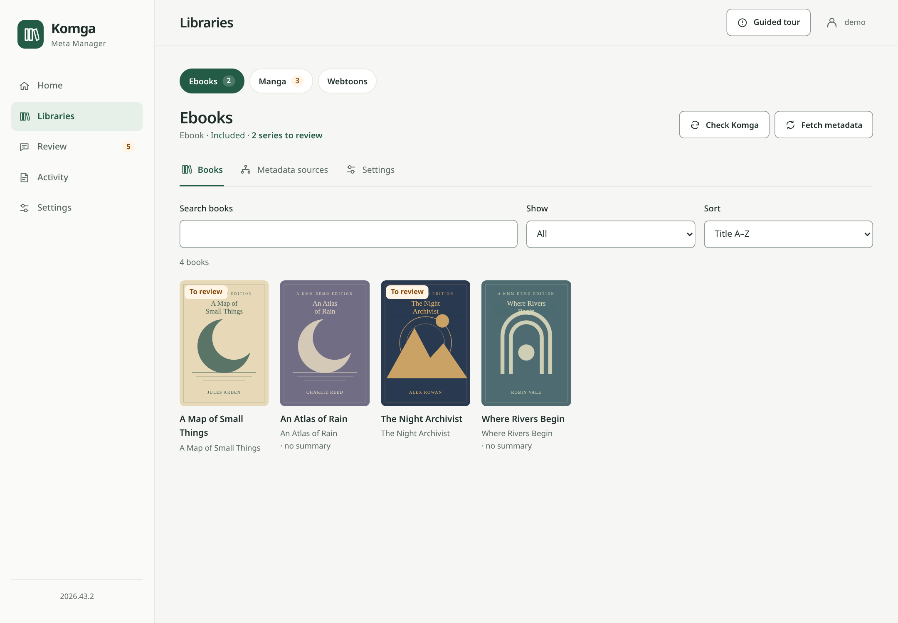
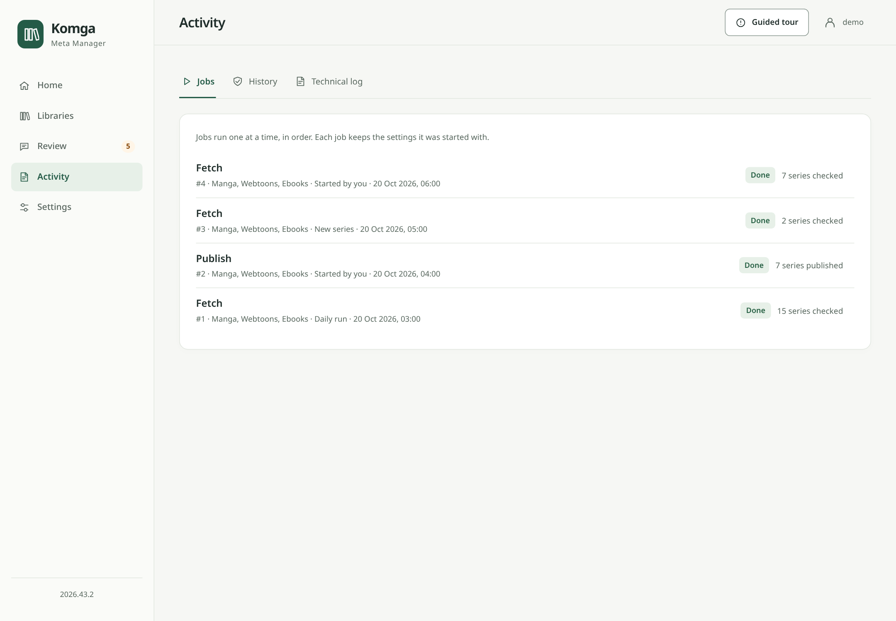

<p align="center">
  
</p>
<h1 align="center">Komga Meta Manager</h1>
<p align="center"><strong>A little order. A better library.</strong></p>
<p align="center">Thoughtful metadata management for your Komga collection.<br>Fetch the missing details. Review every change. Publish when you are ready.</p>
<p align="center">
  <a href="#quick-start">Get started</a> ·
  <a href="https://simon-verbois.github.io/komga-meta-manager/">Website</a> ·
  <a href="docs/USAGE.md">User guide</a> ·
  <a href="CHANGELOG.md">Changelog</a>
</p>



KMM is a self-hosted companion for [Komga](https://komga.org/). It enriches manga and webtoon series, matches individual ebooks, and gives you a clear browser interface for the whole process. There is no YAML to edit for everyday use.

**Also building your reading setup? Meet [Inkora](https://simon-verbois.github.io/inkora/), my Komga reader for phones and tablets.** Read manga, webtoons and ebooks, and download books for offline reading. [Explore Inkora →](https://simon-verbois.github.io/inkora/) · [Inkora on GitHub →](https://github.com/simon-verbois/inkora)

## Fetch → Review → Publish

1. **Fetch** from your chosen sources into KMM's own catalogue. Fetching never modifies Komga.
2. **Review** the before/after values. Discard a suggestion, edit a field yourself, or keep it for later.
3. **Publish** all changes or selected series to Komga when you are ready.

Existing values and Komga field locks are preserved by default. Clearing fields, replacing values and automatic publishing are explicit choices. Saving settings does not start a job; running and queued jobs keep the settings they started with.



## Made for your shelves

| What you need | What KMM provides |
| --- | --- |
| **Manga & webtoon metadata** | AniList, MangaDex and MangaUpdates, with source order, language options and matching thresholds. Coverage depends on the source catalogue. |
| **Individual ebook matching** | Open Library, Google Books and BnF; ISBN-first lookup, title/author fallback and manual edition selection. Google Books requires an API key. |
| **Your own library rules** | Library discovery, inclusion in automatic runs, content types, inherited defaults and per-library overrides. |
| **Metadata you can trust** | Before/after review, individual field discards, explicit publication and preservation of existing values, locks and manual edits. |
| **A personal touch** | Edit metadata and covers, organize book numbering and format manga/webtoon book titles without renaming files. |
| **Reusable source choices** | Built-in manga, webtoon and ebook templates, plus personal templates and defaults per content type. |
| **Help with the routine** | Daily scheduling, new-series detection, optional summary translation through Google Translate or DeepL, and persistent caches. |
| **A clear history** | Persistent job queue, job results, action history and downloadable logs. |

KMM's application interface is English. The presentation website is available in **English, French, Dutch, German and Spanish**. Ebook enrichment targets individual books; it does not rewrite parent-series metadata from a matched edition. [Read about matching and field scope](docs/USAGE.md#metadata-providers-and-matching).

## Quick start

You need Docker Compose, a running Komga server and a Komga API key.

Save this as `compose.yml` in a new folder:

```yaml
services:
  kmm:
    image: simonverbois/komga-meta-manager:latest
    restart: unless-stopped
    ports:
      - "8765:8765"
    volumes:
      - ./config:/config
```

Start KMM:

```bash
docker compose up -d
```

Open **[localhost:8765](http://localhost:8765)**:

1. Create your KMM account.
2. Enter your Komga address and API key, then test the connection. Use a Komga address reachable from the container.
3. Choose the libraries to manage and their content types.
4. Select **Save and fetch metadata**, review the proposals, then publish your selection.

The account, configuration, local catalogue, manual edits and history are stored in `/config/webui.db`. **Back up the mounted `./config` directory.** An existing legacy `config.yml` is imported on first startup; subsequent configuration is managed in the web interface.

For deployment from this repository, use the included [compose.yml](compose.yml). Kubernetes manifests and setup instructions are in [k8s-manifest/README.md](k8s-manifest/README.md).

## A closer look

<details>
<summary><strong>Home — the next step at a glance</strong></summary>



</details>

<details>
<summary><strong>Sources — the right metadata for each library</strong></summary>



</details>

<details>
<summary><strong>Editor — your own metadata, kept for review</strong></summary>



</details>

<details>
<summary><strong>Ebooks — individual books and compatible sources</strong></summary>



</details>

<details>
<summary><strong>Activity — follow each job and its result</strong></summary>



</details>

All screenshots show the actual KMM interface with an isolated **fictional catalogue and original sample covers**. They show the development version; published releases may differ. No personal library, server data or credentials are used. [Reproduce the captures](docs/PAGES.md#screenshots).

## Inkora: the reading side of your Komga library

KMM looks after metadata. **[Inkora](https://simon-verbois.github.io/inkora/)** is my separate Komga reading app for manga, webtoons and ebooks on phones and tablets, with offline downloads and reading progress synchronization.

Android is tested; native iOS validation is still pending. The two projects work independently: KMM does not require Inkora, and you can keep using your preferred Komga reader.

**[Visit the Inkora website →](https://simon-verbois.github.io/inkora/)** · **[Browse Inkora on GitHub →](https://github.com/simon-verbois/inkora)**

## Documentation & development

- [User guide](docs/USAGE.md): editing, matching, rules, sources, jobs and backup.
- [Contributing and development](CONTRIBUTING.md): dependencies, tests, local container and releases.
- [Website and screenshot maintenance](docs/PAGES.md): local preview, translations, browser checks and GitHub Pages setup.
- [Kubernetes deployment](k8s-manifest/README.md).
- [Interface conventions](design-system/README.md).
- [Changelog](CHANGELOG.md).

Licensed under the [MIT license](LICENSE). A personal project, shared as-is, without warranty or guarantee of maintenance. KMM and Inkora are independent of the Komga project.
